

  

<h1 align="center">NoPonto</h1>

<strong>O transporte do Rio, mais perto de você.</strong>

  Acompanhe linhas, veículos, paradas e previsões de chegada em um só lugar. 
  Uma experiência de mobilidade urbana em evolução, feita para quem depende do transporte público.

  <a href="#experimente-o-noponto">Baixar para Android</a> ·
  <a href="#conheça-o-aplicativo">Conhecer o aplicativo</a> ·
  <a href="#o-que-já-existe-e-o-que-vem-depois">Estado das funcionalidades</a>

---

## Experimente o NoPonto

O **NoPonto está disponível em versão beta para Android**. O APK pode ser instalado diretamente no celular, sem precisar do Expo Go.

  <strong>Versão mais recente: NoPonto v5.3 Beta — Nova Interface</strong> 
  Publicada em 14/11/2026 (horário de Brasília) · APK Android de testes

  <a href="https://github.com/UVAEstudantes/.github/releases/download/v5.3-beta/NoPonto.apk"><strong>Baixar o APK — v5.3 Beta</strong></a>
   
  <a href="https://github.com/UVAEstudantes/.github/releases">Ver todas as versões publicadas</a>

  
   
  Clique no QR Code para abrir a página de releases. Para obter a versão mais recente, use o link v5.3 acima.

> **Versão de testes:** o aplicativo está em desenvolvimento. Alguns dados dependem de serviços externos, da cobertura de cada modal e de permissões do Android. Posições e horários exibidos são informações operacionais ou estimativas, não garantias de chegada.

---

## Conheça o aplicativo

### O transporte ganha vida no mapa

O mapa é o ponto de partida do NoPonto. Nele, você pode visualizar **percursos, paradas e veículos**, filtrar o transporte por modal e acompanhar as linhas de interesse.

Ao tocar em um veículo, o app apresenta detalhes como **linha, sentido, estado da atualização GPS, velocidade, distância e próxima parada**, conforme os dados disponíveis. Ao escolher uma parada, mostra as próximas chegadas estimadas, permitindo acompanhar o transporte a partir do lugar onde você pretende embarcar.

  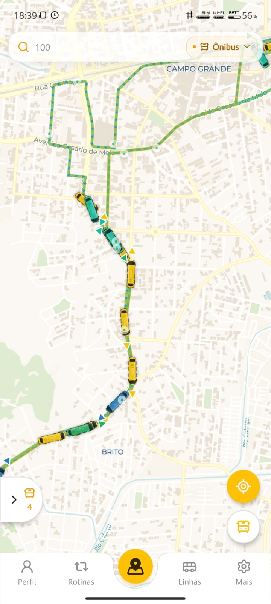
  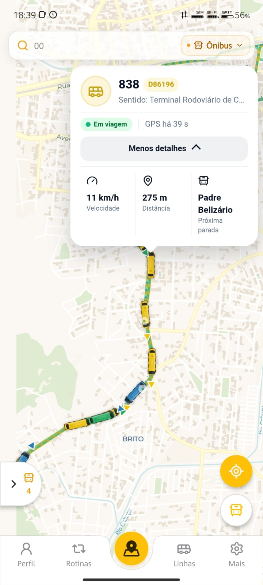
  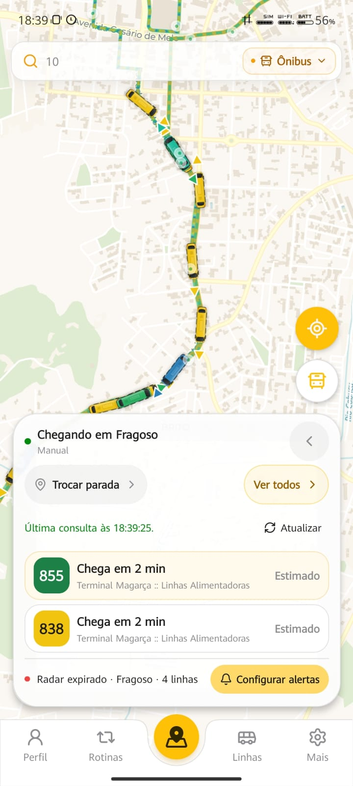

Mapa ao vivo · Detalhes do veículo · Próximas chegadas na parada

O usuário também pode selecionar linhas, alterar a visualização de percursos e paradas, consultar sentidos e guardar suas linhas favoritas. A atualização dos veículos depende dos sinais recebidos das fontes de transporte.

### Informações da parada, sem complicação

O NoPonto reúne os dados essenciais da parada em um único painel: **linhas que passam por ela, próximos veículos, horários estimados e distância**, quando disponíveis. É possível atualizar a consulta e abrir a lista das linhas atendidas.

Para facilitar os primeiros passos, o aplicativo também inclui um **tutorial interativo**, que apresenta os controles e recursos do mapa.

  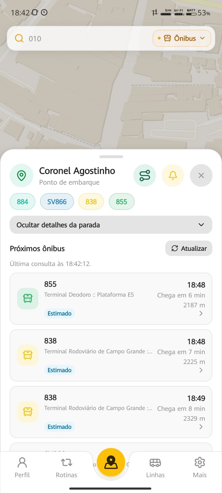
  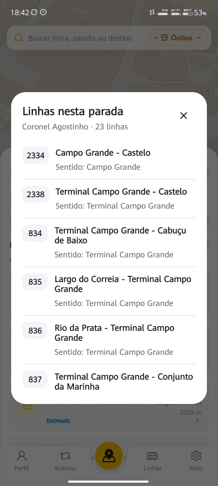
  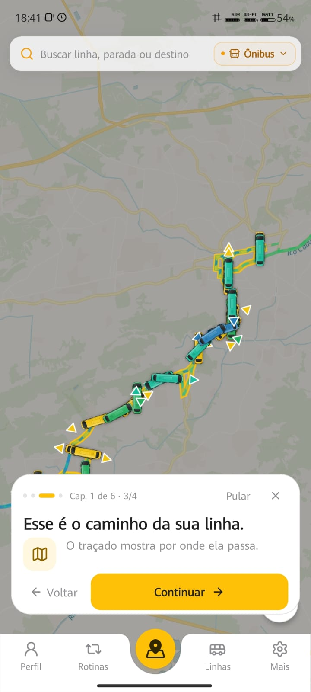

Consulta da parada · Linhas nesta parada · Tutorial interativo

### Radar de Espera: acompanhe sem olhar o mapa o tempo todo

O **Radar de Espera** permite selecionar as linhas de uma parada e configurar um acompanhamento de chegadas. É possível destacar linhas prioritárias e ajustar a antecedência desejada para os avisos.

No Android, o Radar conta com **notificações de acompanhamento e recursos de avisos por voz**, incluindo opções para controlar ou silenciar a narração sem necessariamente interromper o Radar. A operação remota utiliza serviços do aplicativo e depende de conectividade, permissões, configuração do dispositivo e disponibilidade das previsões.

  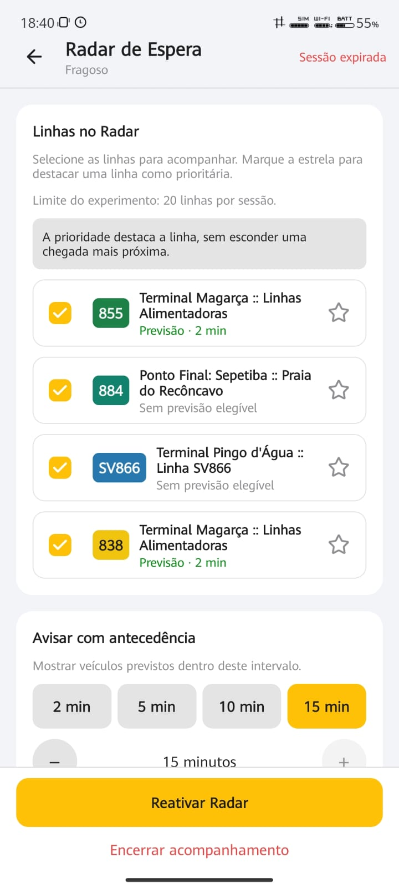

Escolha as linhas acompanhadas e quando deseja ser avisado.

As notificações podem resumir a chegada de mais de uma linha e oferecer ações rápidas, como **parar o Radar** ou **silenciar a voz**.

  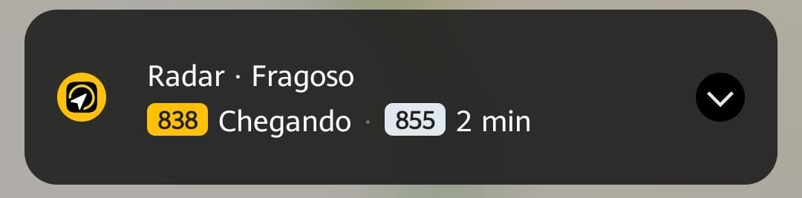
  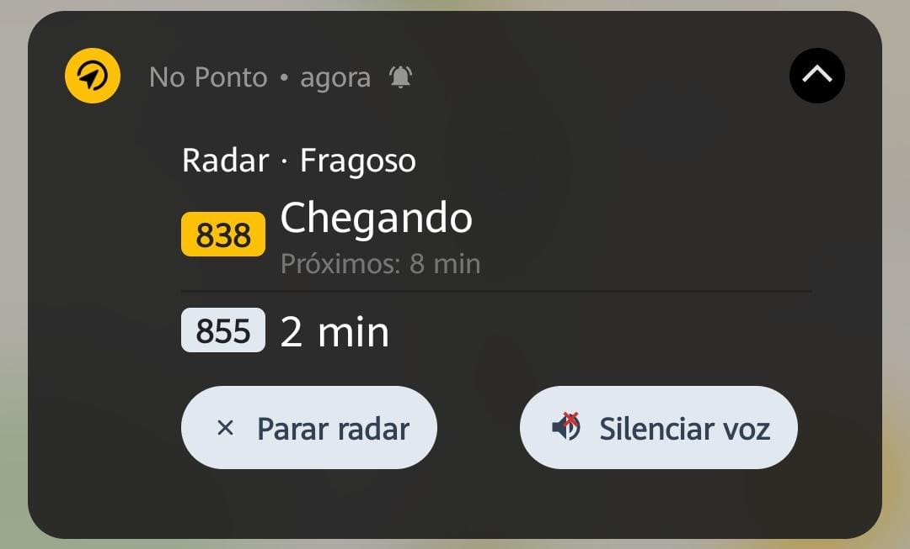

Notificação compacta e expandida no Android.

### Favoritos, perfil e uma visão das suas viagens

O NoPonto também ganhou uma área de **Perfil**, com nome e cor do avatar armazenados localmente no aparelho e acesso às linhas favoritas. Não é necessário criar uma conta para personalizar esses dados.

A interface já apresenta uma proposta de estatísticas de mobilidade — como distância percorrida, linhas utilizadas e atividade semanal —, mas **esses indicadores ainda são demonstrativos**, sem histórico real de viagens ou autenticação de usuário.

  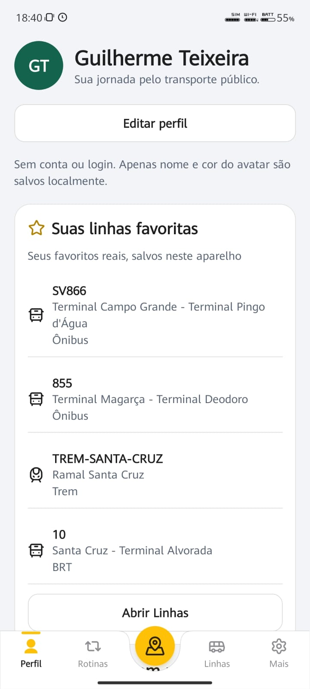
  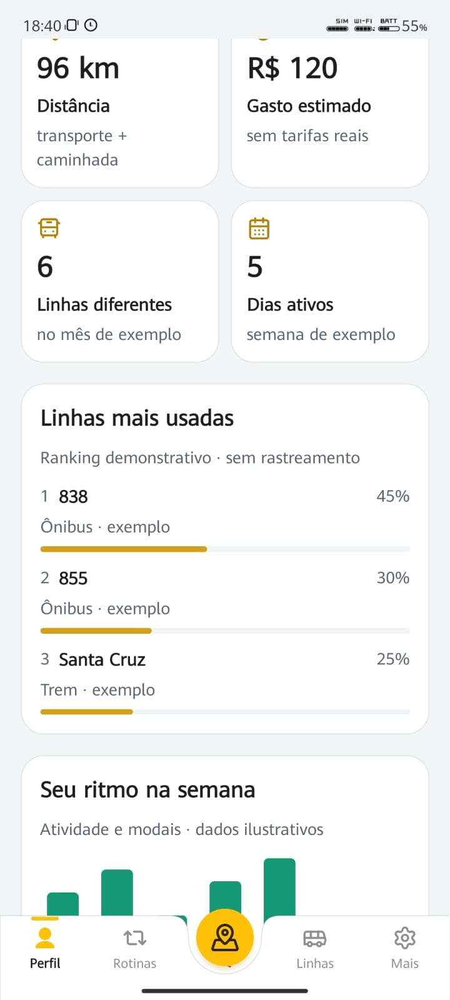

Perfil e favoritos locais · Prévia das futuras estatísticas pessoais

### Rotinas: a próxima etapa da jornada

A área de **Rotinas** já possui uma interface para explorar a ideia de cadastrar deslocamentos habituais, como o caminho de casa até a faculdade ou o trabalho. Ela mostra exemplos de trajetos que combinam caminhada e transporte público.

**Por enquanto, essa experiência é uma prévia interativa:** os percursos são ilustrativos e ainda não existe um motor de rotas multimodais, acompanhamento completo de viagens ou alertas reais de rotina. A proposta é evoluir para orientações ao longo do trajeto, aproveitando as informações operacionais e os avisos do Radar.

  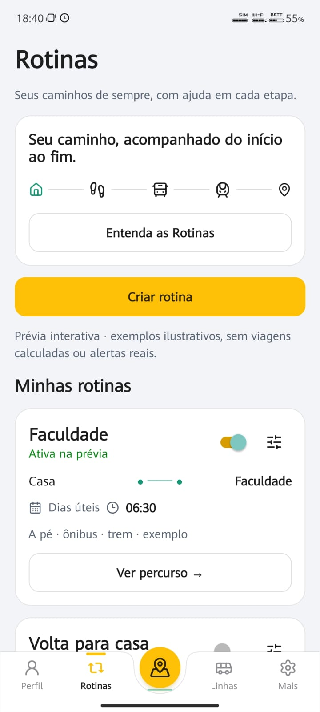

Interface de Rotinas em desenvolvimento, com exemplos de deslocamentos.

---

## Um aplicativo para diferentes modais

O projeto busca reunir a mobilidade do Rio de Janeiro em uma experiência única:

- **Ônibus:** itinerários, paradas, acompanhamento de veículos e estimativas quando houver dados elegíveis.
- **BRT:** linhas e acompanhamento conforme a integração e a disponibilidade das fontes.
- **Trem:** ramais, estações e acompanhamento baseado em horários e dados operacionais. As posições ferroviárias podem ser **inferidas**, e não medições GPS diretas.
- **Metrô:** faz parte da proposta multimodal e da evolução das integrações; a cobertura operacional não deve ser presumida como concluída.

Cada modal possui fontes, características e níveis de cobertura diferentes. Quando uma posição é estimada ou a fonte está desatualizada, essa limitação importa para interpretar o resultado.

## O que já existe e o que vem depois

| Área | Estado do projeto |
| --- | --- |
| Mapa, linhas, sentidos e itinerários | **Implementado**, com melhorias e ajustes contínuos |
| Veículos e estimativas de chegada | **Disponíveis conforme a fonte e a qualidade dos dados** |
| Paradas e consulta de próximas chegadas | **Implementado**, com atualização e detalhes de linhas |
| Radar de Espera, notificações e voz | **Implementado para testes no Android**, sujeito a permissões e serviços |
| Favoritos, preferências, tutorial e perfil local | **Implementado** |
| Estatísticas pessoais de mobilidade | **Interface demonstrativa**, sem coleta real de trajetos pessoais |
| Rotinas e percursos personalizados | **Prévia interativa**; automação e roteamento ainda não concluídos |
| Planejamento de rotas multimodais | **Planejado**, incluindo caminhada, embarques e baldeações |

A prioridade é transformar informações operacionais em algo realmente útil durante a espera e, no futuro, **durante todo o deslocamento**. Entre as evoluções estudadas estão roteamento por transporte público, rotinas acompanhadas, mais recursos de acessibilidade e informações colaborativas sobre a experiência nas linhas e paradas.

## Tecnologia

O aplicativo é desenvolvido com **React Native, Expo e TypeScript**, incluindo recursos nativos Android para o Radar. O backend utiliza **ASP.NET Core / .NET 9, PostgreSQL/PostGIS, Redis e SignalR**, com integração de fontes externas e processamento de dados de transporte.

A arquitetura procura relacionar veículos, linhas, itinerários e paradas, mantendo separadas as informações recebidas diretamente das fontes e as posições ou chegadas estimadas.

  
  &nbsp;
  
  &nbsp;
  

---

## Da universidade para as ruas

O NoPonto nasceu como **Trabalho de Conclusão de Curso de Ciência da Computação da Universidade Veiga de Almeida (UVA)**, com o propósito de aplicar desenvolvimento de software, integração de dados e geoprocessamento a um problema cotidiano: tornar o uso do transporte público mais compreensível, previsível e acessível.

É um projeto acadêmico em evolução, com a ambição de continuar crescendo além do TCC.

<strong>NoPonto — o transporte do Rio, mais perto de você.</strong>

