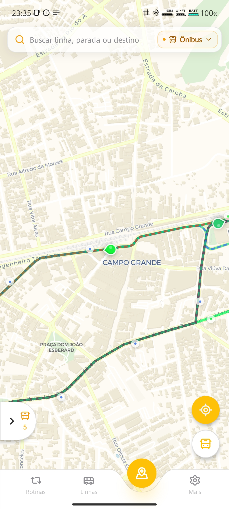
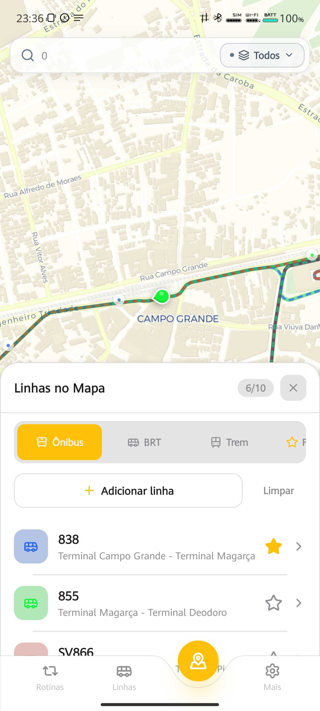
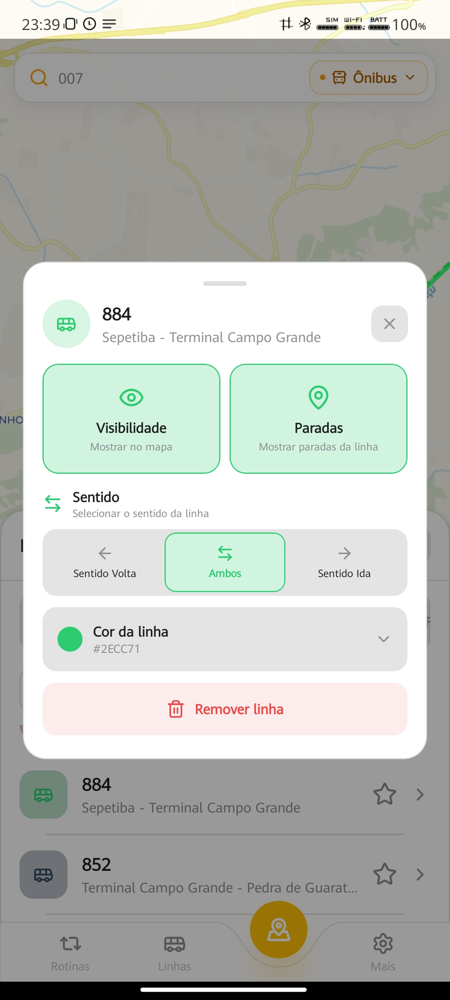
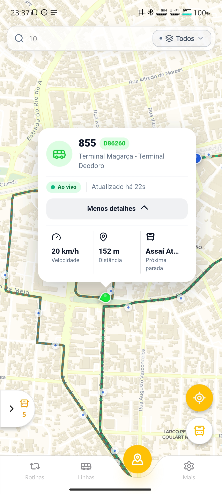
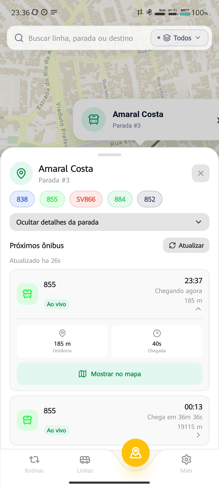
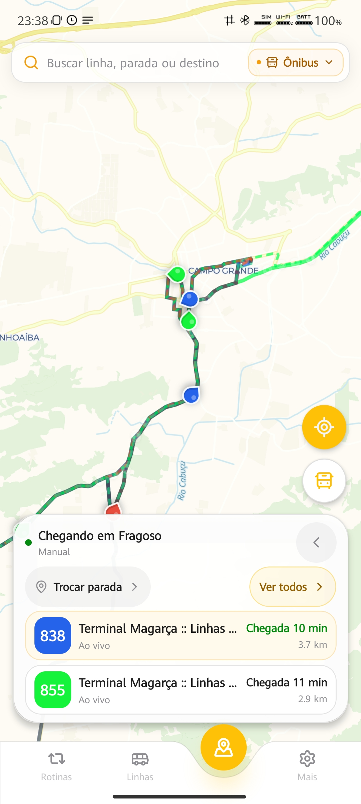
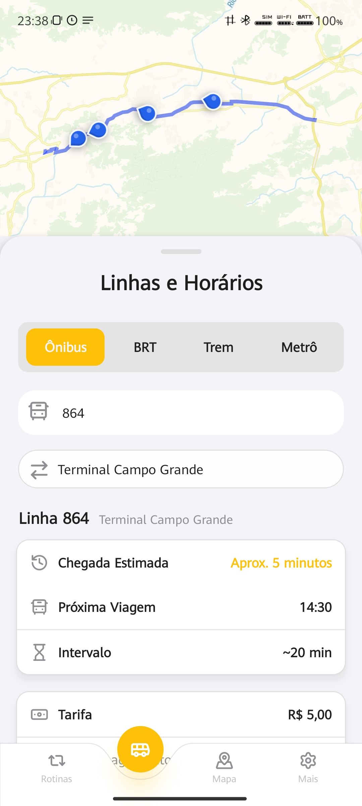
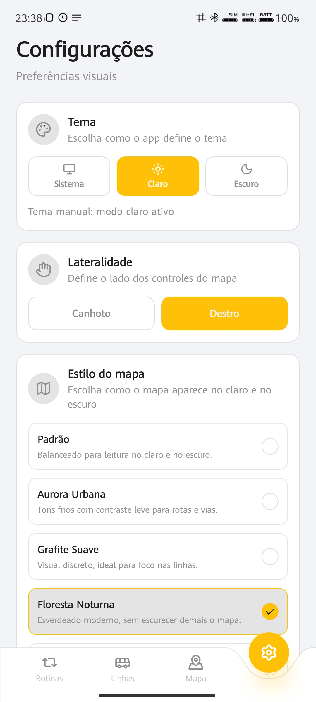

  

<h1 align="center">NoPonto</h1>

<strong>O transporte do Rio, mais perto de você.</strong>

Linhas, percursos e previsões de chegada em uma experiência mobile. Um projeto em desenvolvimento para tornar o deslocamento urbano mais previsível e acessível.

---

## Onde está meu transporte? Quando ele chega?

Quem depende do transporte público precisa conectar informações que muitas vezes estão espalhadas: o percurso de uma linha, a parada certa, a posição do veículo e o tempo de espera. O **NoPonto** reúne essas consultas em uma interface centrada no mapa, com foco inicial no Rio de Janeiro.

A visão é integrar **Ônibus, BRT, Trem e Metrô**. Essa integração avança por etapas: os modais têm diferentes fontes de dados, coberturas e níveis de acompanhamento. O aplicativo ainda está em desenvolvimento; as telas abaixo apresentam a experiência atual, incluindo interfaces que continuam sendo integradas e validadas.

## Explore o mapa e escolha suas linhas

O mapa aproxima a rede de transporte do lugar onde você está. Percursos, paradas e veículos disponíveis ajudam a entender quais linhas passam pela região e como elas se conectam ao seu deslocamento.

Selecione as linhas que deseja acompanhar e ajuste a visualização: mostrar ou ocultar percursos e paradas, escolher o sentido e mudar a cor de cada linha. A busca de linhas e os filtros por modal fazem parte dessa exploração; a pesquisa ampliada por locais e endereços é uma evolução planejada.

  
  
  

Da esquerda para a direita: explorar a região, selecionar linhas e personalizar o percurso.

## Do veículo à próxima chegada

Ao selecionar um veículo, a interface apresenta a linha, a atualização recebida e informações como velocidade e próxima parada, quando disponíveis. Ao abrir uma parada, você pode consultar as linhas atendidas e os próximos veículos com suas estimativas de chegada.

O painel de acompanhamento no mapa também reúne próximas chegadas para a parada escolhida. Assim, a consulta pode partir tanto de um veículo quanto do ponto onde você pretende embarcar.

  
  
  

Detalhes do veículo, consulta da parada e acompanhamento das próximas chegadas.

**Previsões são estimativas.** Sua disponibilidade depende da linha, do modal, da qualidade dos dados e da atualização da fonte. A indicação de atualização ajuda a interpretar a informação; ela não garante que a posição permaneça atual nem que o veículo chegue no minuto previsto.

## Uma experiência que se adapta ao uso

A tela **Linhas e Horários** organiza a consulta de linhas, sentidos e percursos. As preferências visuais permitem escolher o tema, o estilo do mapa e o lado dos controles para uso com a mão esquerda ou direita.

  
  

Consulta de linhas e preferências de apresentação.

Na captura de **Linhas e Horários**, os cartões de chegada, próxima viagem e intervalo ainda incluem valores demonstrativos da interface, pendentes de integração. Eles não representam horários operacionais confirmados. A aba Metrô expressa a direção multimodal do produto, sem indicar acompanhamento operacional já disponível.

Os favoritos de linhas já possuem implementação, com integração ao mapa em validação. A experiência de rotinas completas continua como evolução futura.

## Como os dados se tornam acompanhamento

**Fontes de transporte → processamento → contexto de linha e veículo → aplicativo**

Para **Ônibus e BRT**, o backend recebe posições de fontes externas e procura associá-las às linhas, aos sentidos e aos itinerários correspondentes. Esse contexto permite exibir veículos no mapa e relacionar seu movimento às próximas paradas. O acompanhamento depende das posições recebidas e da capacidade de reconhecer corretamente o percurso.

Nos **trens**, a abordagem é diferente: uma posição GPS direta nem sempre está disponível. O projeto combina horários programados, estrutura ferroviária e informações operacionais para identificar viagens e estimar posições. Um serviço previsto na grade e uma estimativa apoiada por informação operacional recente têm evidências diferentes; **posição calculada não é medição GPS**.

O acompanhamento ferroviário está sendo ampliado progressivamente, com operação documentada no ramal Santa Cruz e expansão para outros ramais ainda sujeita a integração e validação. O **Metrô** permanece na visão de integração, sem cobertura operacional confirmada no contexto consultado.

## Previsões que aprendem com a operação

**ETA**, do inglês *Estimated Time of Arrival*, é a previsão de tempo de chegada: quanto um veículo deve levar para alcançar uma parada ou estação. O NoPonto já trabalha com estimativas e desenvolve uma frente de aprendizado de máquina para torná-las mais contextualizadas.

Essa evolução reúne três camadas:

1. **Movimento e percurso.** Distância ao longo do itinerário, velocidade e contexto da posição ajudam a estimar o tempo restante.
2. **Histórico operacional.** Observações dos veículos e registros de passagens formam uma base para estudar o comportamento real de linhas e trechos.
3. **Aprendizado de máquina.** Preparação de dados, treinamento e comparação de modelos buscam reconhecer padrões associados à linha, ao trecho, ao horário, ao dia da semana e ao histórico de deslocamento.

A frente de ML possui ferramentas de treinamento e avaliação, mas a integração do modelo histórico às previsões públicas ainda exige validação. Não há comprovação de ganho de precisão em operação real; resultados com dados sintéticos não são métricas de produção.

Os próximos estudos incluem tempos históricos entre paradas, variação de velocidade por trecho, horários de maior movimento, intervalos, atrasos recorrentes e comportamento de veículos à frente. Novos fatores serão incorporados conforme sua utilidade puder ser demonstrada.

## Além de acompanhar: planejar o caminho inteiro

A maior ambição do NoPonto é ajudar a escolher **como chegar ao destino**, combinando caminhada e diferentes modais em um mesmo deslocamento.

> Origem → Caminhada → Ônibus → Metrô → Caminhada → Destino
>
> Origem → BRT → Trem → Destino

Esses são exemplos conceituais. **O planejamento de rotas multimodais é uma visão futura**, ainda não uma funcionalidade concluída.

A proposta é comparar alternativas considerando tempo total, espera, caminhadas, baldeações, custo, disponibilidade e condições operacionais. Ao combinar a rede de transporte com atualizações e previsões de chegada, o planejamento poderá responder melhor ao que acontece durante a viagem.

## Rotinas inteligentes: seu caminho de todo dia

Ir à faculdade ou ao trabalho envolve um trajeto conhecido, mas condições que mudam a cada dia. A proposta das **Rotinas** é permitir que você cadastre esses deslocamentos habituais e receba informações úteis antes de sair e durante a viagem, sem precisar refazer as mesmas consultas diariamente.

Cada rotina poderá reunir **origem, destino, dias da semana, horário habitual de saída e horário desejado de chegada**, além de linhas e trajetos multimodais preferidos. Preferências como menor caminhada, menos baldeações, menor custo ou maior confiabilidade poderão orientar a comparação entre caminhos.

Combinando **dados em tempo real, ETA, histórico operacional e roteamento multimodal**, o NoPonto poderá acompanhar automaticamente a rotina nos dias e horários configurados. A ideia é comparar as condições atuais com o comportamento habitual, identificar atrasos e intervalos maiores, recomendar um horário de saída e sugerir outro trajeto quando houver uma alternativa mais adequada às suas preferências.

> **Exemplo conceitual — rotina Faculdade**
>
> De segunda a sexta, chegar às 8h, saindo de casa e combinando caminhada, ônibus e metrô.
>
> Antes da saída, o aplicativo poderá avaliar as próximas chegadas e o tempo previsto do percurso. Se a linha habitual estiver mais lenta, poderá avisar: “Sua rota está demorando mais hoje. Considere sair mais cedo ou usar esta alternativa com ônibus e metrô.”
>
> Durante o deslocamento, novas informações poderão atualizar a previsão de chegada e gerar um aviso se uma mudança na operação afetar a próxima conexão.

As **notificações contextuais** deverão acompanhar a intenção do usuário: avisar que está na hora de sair, que o veículo se aproxima ou que um atraso compromete o trajeto cadastrado. A busca unificada e os locais de interesse poderão facilitar a escolha dos destinos; o histórico e as previsões ajudarão a avaliar as alternativas ao longo do caminho.

**Rotinas inteligentes ainda são uma visão futura, não uma funcionalidade disponível.** Sua realização depende da evolução do roteamento multimodal, da cobertura e qualidade das informações operacionais e da validação das previsões e dos dados históricos.

### Outras evoluções

Outras frentes complementam o planejamento de trajetos e as rotinas:

| Frente | O que queremos tornar possível |
| --- | --- |
| Destinos e busca unificada | Encontrar endereços e locais de interesse, como hospitais, universidades e parques, e descobrir como acessá-los pela rede. |
| Favoritos | Ampliar os favoritos de linhas para incluir paradas, estações, trajetos e locais frequentes. |
| Histórico e confiabilidade | Mostrar tempos típicos, frequência e irregularidade das linhas a partir de dados acumulados. |
| Experiência e acessibilidade | Melhorar continuamente a leitura do mapa, a clareza das informações e a interação com os controles. |

Essas frentes estão em planejamento ou evolução, sem compromissos de lançamento definidos. Pontos de interesse ainda não são um catálogo disponível no aplicativo.

## Tecnologia a serviço da mobilidade

O aplicativo utiliza **React Native, Expo e TypeScript**. O backend combina **ASP.NET Core / .NET 9**, **PostgreSQL com PostGIS**, **Redis** e **SignalR**, com processamento geoespacial e integrações com fontes externas de transporte. A frente de aprendizado de máquina utiliza **Python e scikit-learn** para preparar dados e estudar modelos de previsão.

Essa base sustenta os desafios do produto: interpretar informações de diferentes fontes, conectar veículos aos percursos e transformar dados operacionais em consultas compreensíveis.

## Nasceu como TCC. Tem caminho para continuar.

O NoPonto nasceu como **Trabalho de Conclusão de Curso de Ciência da Computação da Universidade Veiga de Almeida**. A motivação é aplicar desenvolvimento de software, integração de dados, geoprocessamento e inteligência computacional a um problema vivido diariamente por quem utiliza transporte público.

O TCC é a origem da plataforma, com pesquisa e desafios reais de engenharia. A perspectiva é continuar aprimorando o acompanhamento, as previsões e a experiência de mobilidade além dessa etapa acadêmica.
